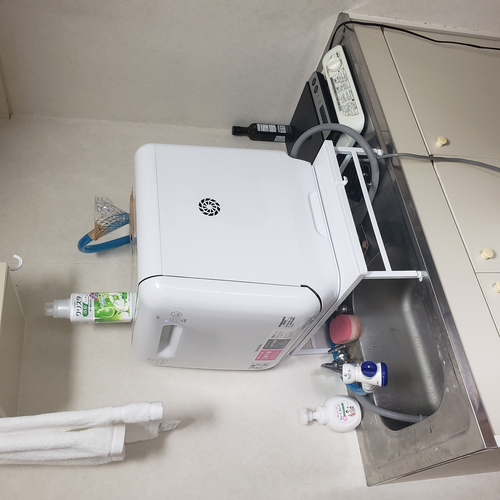
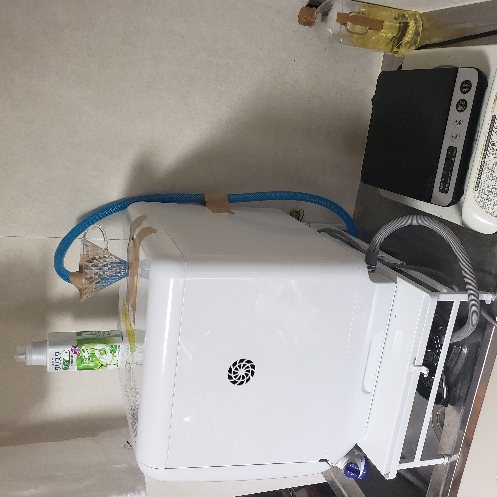
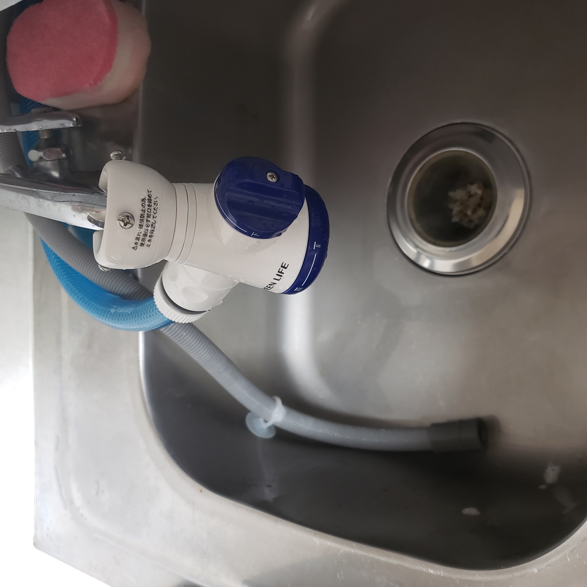
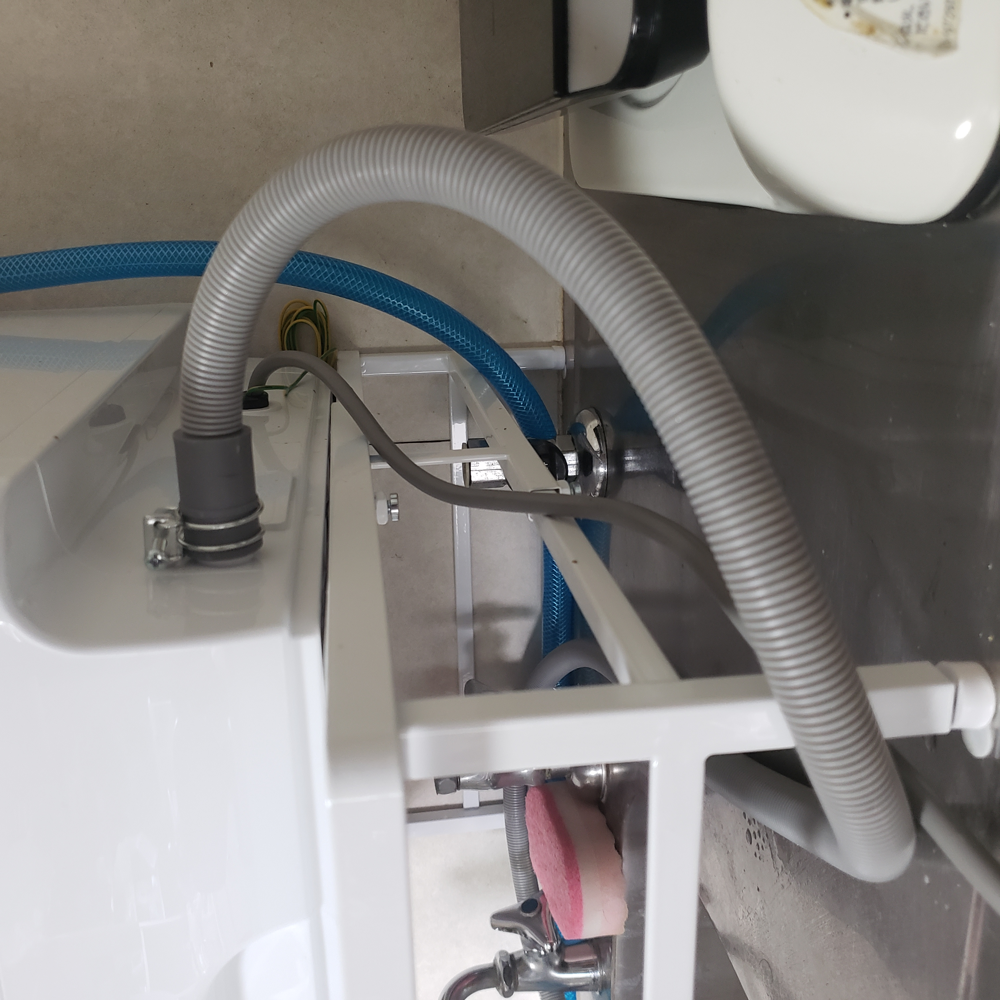
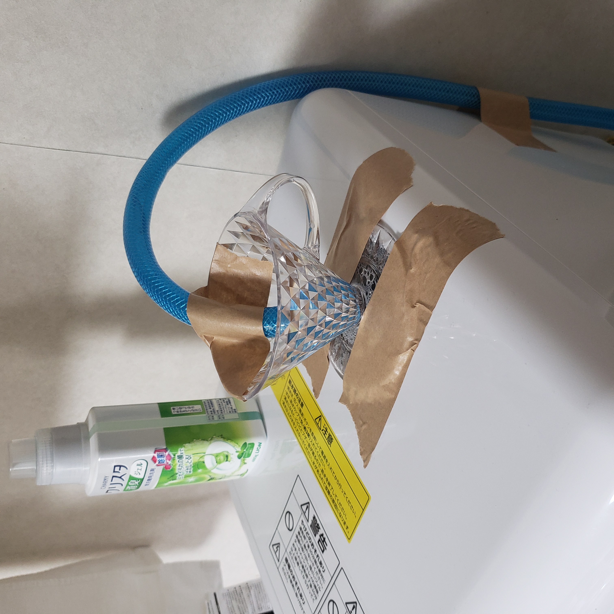
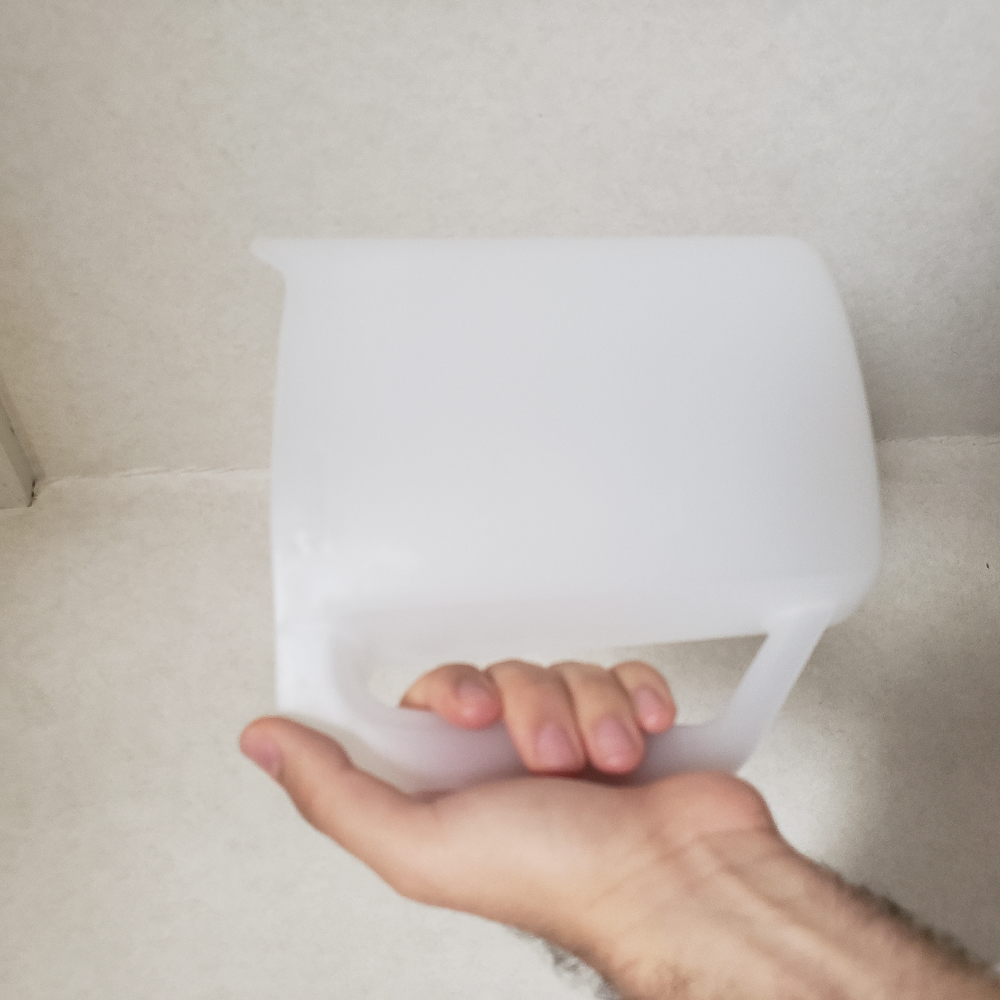

Recently I bought a dishwasher machine and it has been a great time saver for me. Although I spend some money on it, I think on the long run it is worth it. Not only I save money on food by cooking at home more often, but also I can spend more time and energy on things I am interested in rather than on washing dishes.

I put the materials (bought on Amazon JP) and some pictures of the setup in case someone is interested.

# Materials
- [Iris Ohyama ISHT-5000-W Dishwasher and Dryer No Construction Required, Compact, Top and Bottom Nozzle Cleaning, White](https://www.amazon.co.jp/-/en/gp/product/B0811MR8D9/ref=ppx_yo_dt_b_asin_title_o03_s00?ie=UTF8&psc=1)
- [Yamazaki Industries 5181 Extendable Dishwasher Rack](https://www.amazon.co.jp/-/en/gp/product/B08FBQT3BR/ref=ppx_yo_dt_b_asin_title_o01_s01?ie=UTF8&psc=1)
- [Dishwasher Detergent - チャーミークリスタ 消臭ジェル 食洗機用洗剤 本体 480g](https://www.amazon.co.jp/-/en/gp/product/B07G2CX83D/ref=ppx_yo_dt_b_asin_title_o01_s00?ie=UTF8&psc=1)
- [Dishwasher Detergent REFILL - 【大容量】チャーミークリスタ 消臭ジェル 食洗機用洗剤 詰め替え 840g](https://www.amazon.co.jp/-/en/gp/product/B00MWJ6M2M/ref=ppx_yo_dt_b_asin_title_o01_s00?ie=UTF8&psc=1)
- [Green Life SJC-01 Connector, Faucet Connector with Shower, Two-Way Type, One-Touch Water Direction](https://www.amazon.co.jp/-/en/gp/product/B0092ITHPU/ref=ppx_yo_dt_b_asin_title_o01_s00?ie=UTF8&psc=1)
- [Takagi Hose Clear High Pressure Hose](https://www.amazon.co.jp/-/en/gp/product/B00CTGTN92/ref=ppx_yo_dt_b_asin_title_o01_s00?ie=UTF8&psc=1)
- [Coffee Dripper as adapter for the hose (I used this because I already had it but you can improvise with other)キーコーヒー Noi クリスタルドリッパー](https://www.amazon.co.jp/-/en/dp/B00TOCKFQ4/ref=sr_1_9)

# How it looks

