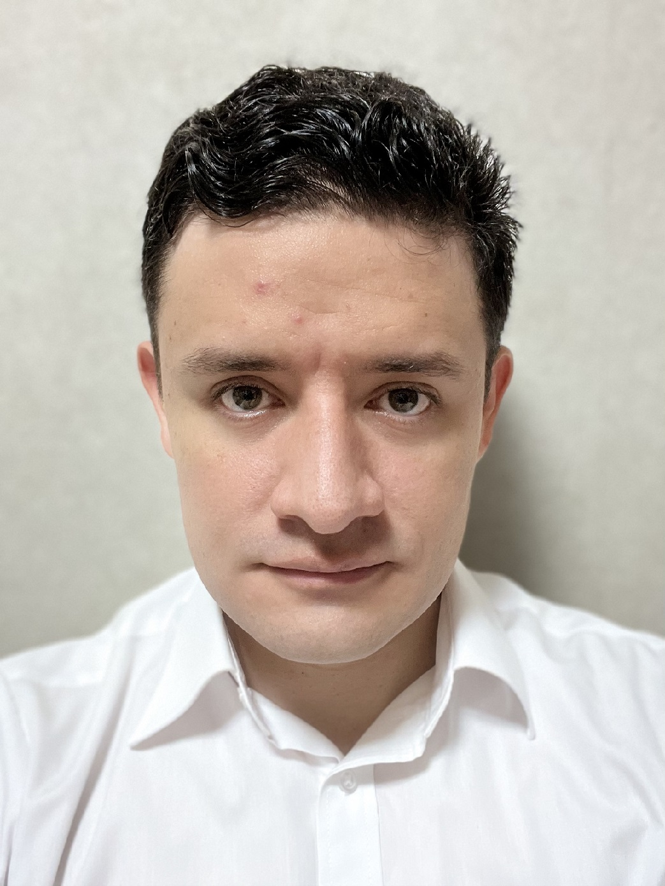

<!--  -->

<!--  -->

I am a doctoral student at the [Mathematical Informatics Lab][mi-lab], at [Nara Institute of Science and Technology (NAIST)][naist].

My research topic is Task Similarity for Transfer Learning in Reinforcement Learning. 

Interests: Machine Learning, Reinforcement Learning, Information Geometry, Information Theory, Competitive Programming.
 
 
 
 
 

# Education
- **Ph.D. student, Information Science** (2020 - present), Nara Institute of Science and Technology, Japan.
- **Research student, Information Science** (2019 - 2020), Nara Institute of Science and Technology, Japan.
- **M.Sc., Computer Science** (2014 - 2017), Centro de Investigacion en Computacion, Instituto Politecnico Nacional, Mexico.
- **B.Eng., Computer Engineering** (2008 - 2014), Facultad de Ingenieria, Universidad Nacional Autonoma de Mexico, Mexico.

# Work Experience
- **RICH IT, Mexico. Data Scientist**, full-time (September 2017 - March 2019). 
    - Optimization of Big Data platforms (Confluent, Elasticsearch, Greenplum, Hortonworks) 
    - Collaborated on Data Science projects implemented on these platforms.
- **REDCONTEL, Mexico. Software Engineer**, part-time (September 2009 - August 2013), full-time (September 2013 - July 2014). 
    - Lead programmer (mainly using C in Linux) of SSH module for a network security system. 
    - Collaborated with other modules using SFTP and VNC protocols.

[mi-lab]: https://sites.google.com/view/milab/
[naist]: https://www.naist.jp/en/
[master-thesis]: https://www.saber.cic.ipn.mx/SABERv3/Repositorios/webVerArchivo/25689/1
[bachelor-thesis]: http://www.ptolomeo.unam.mx:8080/xmlui/bitstream/handle/132.248.52.100/4044/Tesis.pdf?sequence=1
